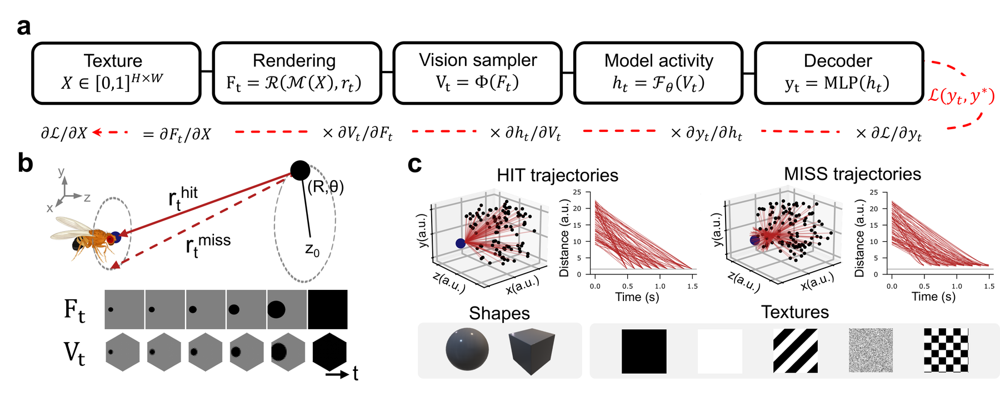

# flynet-robustness

Code and trained networks for the NeurIPS 2026 paper **"Measuring Robustness and
Efficiency in a Connectome-Constrained Fly Visual System Model: Linking an
Adversarial and a Perceptual Illusion."**



A looming object is rendered in 3D, sampled onto the fly's hexagonal
photoreceptor lattice, run through a network and read out by an MLP decoder
(**a**). Every step is differentiable, so the loss can be pushed all the way
back to the texture and used to attack it. Objects approach on hit or near-miss
trajectories and vary in shape and texture (**b**, **c**). This repository runs
that pipeline for 14 networks and measures how each degrades under adversarial
and environmental perturbations.

## Install

```bash
pip install -e .
```

Plus, separately: [`pytorch3d`](https://github.com/facebookresearch/pytorch3d)
(Linux only), [`flyvis`](https://github.com/lappalainenj/flyvis) — use the
`neurips2026` release of that fork, which is **required for CTRNN and sCTRNN**
(upstream [TuragaLab/flyvis](https://github.com/TuragaLab/flyvis) lacks the
edge-matched and pruned connectomes) — and a
[RAFT](https://github.com/princeton-vl/RAFT) checkout on `PYTHONPATH` (only
`core.raft` is needed; the hex-Sintel preprocessing is vendored in
`flynet_robustness/raft_hex.py`). `RAFT/core` is added to `sys.path`
automatically, since upstream `core/raft.py` imports its siblings bare.

Check the parts that need none of those:

```bash
python scripts/smoke_test.py
```

## Assets

Decoders and the CNN / RAFT-HexSintel checkpoints:

```bash
python scripts/download_assets.py --weights          # ~560 MB, skips what you have
```

from [huggingface.co/alejandrorg00/flynet-robustness](https://huggingface.co/alejandrorg00/flynet-robustness).
Two sets are not there:

- **vanilla RAFT** (`RAFTsmall`, `RAFT_1/6/12`) — `models.zip` from the RAFT
  authors; put `raft-small.pth` and `raft-sintel.pth` in `models/`
- **CTRNN and sCTRNN** — flyvis archives, supplied separately

Then the flyvis networks, which also synthesises FlyNet:

```bash
python scripts/download_assets.py 0003.tar.gz ctrnn_edge_matched.zip
```

sCTRNN needs `ConnectomeWithPrunedEdges`, which the `neurips2026` fork provides.
`$FLYNET_CHECKPOINTS`, `$FLYNET_RAFT_MODELS` and `$FLYNET_DECODERS` override
where these land; set them before importing `flynet_robustness`.

## Networks

`config.PAPER_NETWORKS`, in reporting order:

```
FlyNet  sCTRNN  CTRNN
vCNN_2_frames  vCNN_5_frames  vCNN_10_frames  gCNN_2_frames
RAFTsmall  RAFT_1  RAFT_6  RAFT_12
RAFT_1_S  RAFT_6_S  RAFT_12_S
```

Old ids (`raft_large`, `0`, `flynet_synthesized`, ...) still resolve.

## Run

```bash
# adversarial attacks -> PGD/ CW/ NES/ under --results
python scripts/run_attacks.py --networks all --attack pgd --results results
python scripts/run_attacks.py --networks all --attack cw  --results results
python scripts/run_attacks.py --networks all --attack nes --results results

# transfer: each network's PGD textures on the others (needs the PGD runs above)
python scripts/run_transfer.py --norm both --pgd-root results --results results

# video perturbations -> results/Environmental/*.csv
python scripts/run_perturbations.py --networks all --results results
```

`--networks` also takes any subset of ids. Split a long job into blocks with
`--start-trajectory`. `-h` lists the rest.

The CSVs are `network,R,R_std,LERS,flops`. `data/reference_results/` holds
the same table from the published run, in the same columns, to check a
rerun against.

## Notebooks

| | |
|---|---|
| `01_generate_stimuli` | render trajectories, angular size, GIFs |
| `02_forward_and_decode` | forward pass, p(hit), position/velocity |
| `03_video_perturbations` | noise, flicker, jitter, fog sweeps |
| `04_adversarial_attacks` | PGD, CW, NES |
| `05_reverse_phi_and_neural` | reverse-phi, recurrence, locality, RSA |
| `06_train_decoders` | generate activity, train the decoders |
| `07_illusion_mechanism` | what the adversarial texture does to the motion code |
| `08_transfer_attacks` | transfer matrix across networks |

Run them from the repository root.

## Citation

```bibtex
@inproceedings{garciaduran2026flyillusions,
  title     = {Measuring Robustness and Efficiency in a Connectome-Constrained Fly Visual System Model:
               Linking an Adversarial and a Perceptual Illusion},
  author    = {Garcia-Duran, Alexandre and Rodriguez-Garcia, Alejandro and
               Molano-Mazón, Manuel and Hyafil, Alexandre and
               Ramaswamy, Srikanth and Lappalainen, Janne K.},
  booktitle = {The Fortieth Annual Conference on Neural Information Processing Systems},
  year      = {2026},
  url       = {TBA}
}
```

## License

MIT — see [LICENSE](LICENSE).
